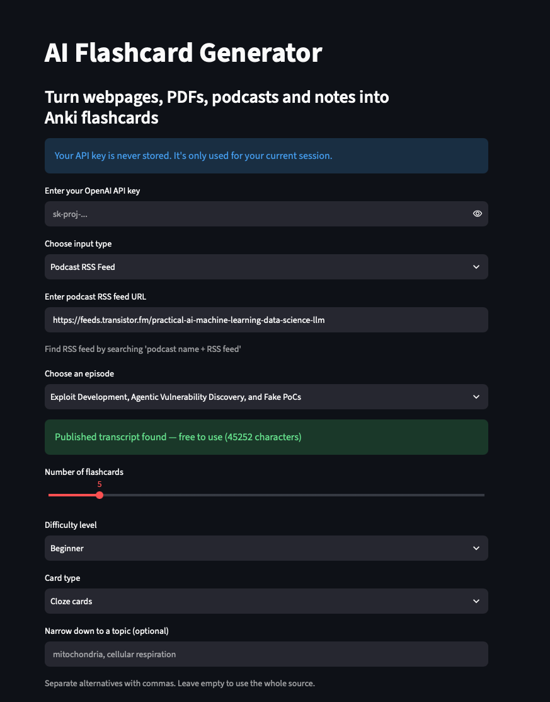
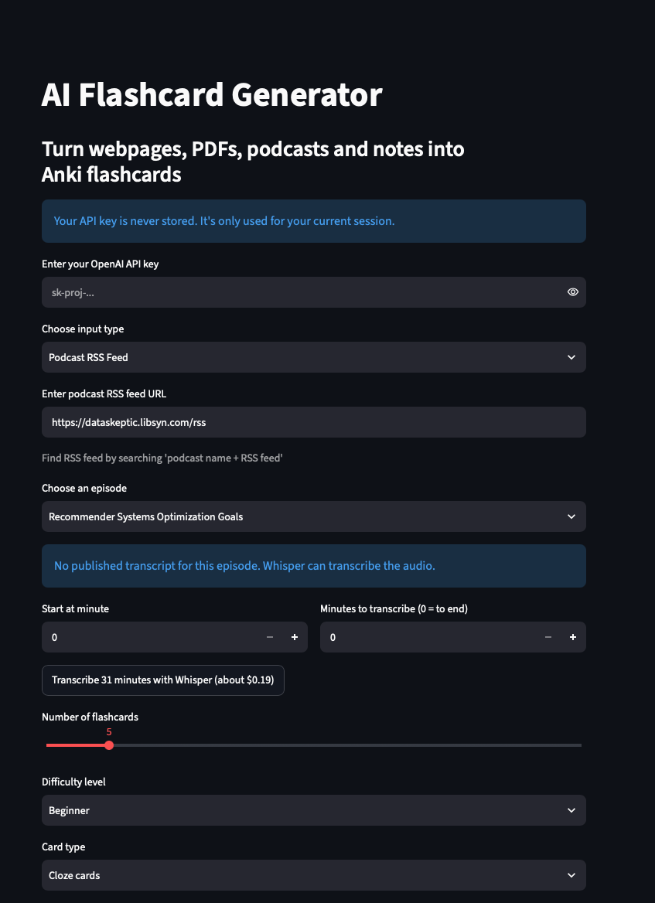
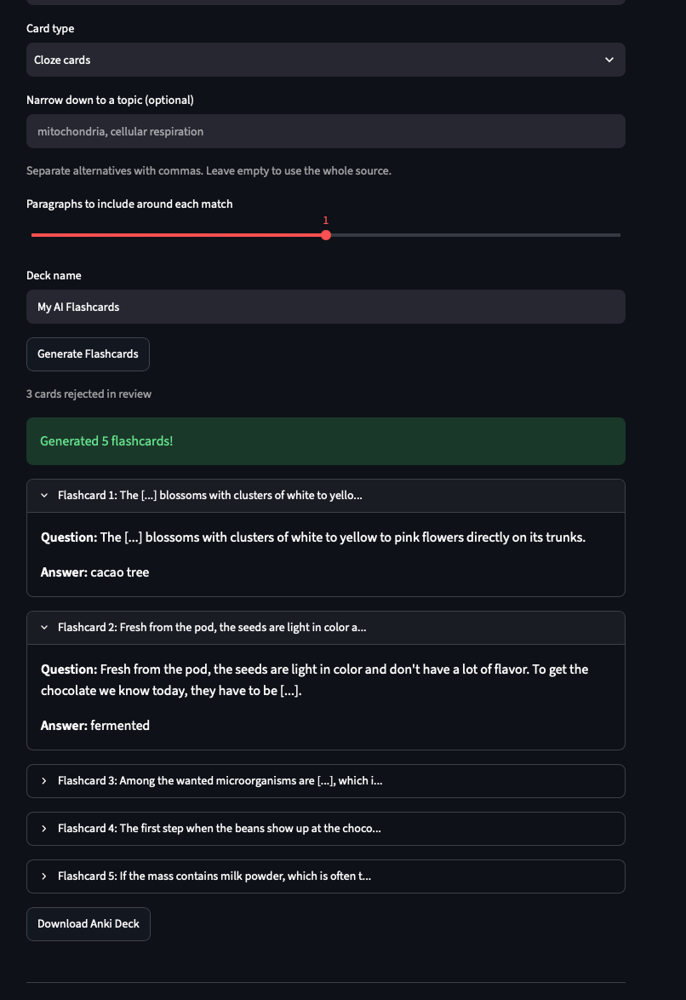

# AI Flashcard Generator

Final project for the Building AI course

## Summary

AI Flashcard Generator turns webpages, PDFs, podcasts, YouTube transcripts and your own notes into Anki flashcards. It writes Q/A and cloze cards with an OpenAI model, has the model review its own cards and drop the weak ones, and exports a ready-to-import `.apkg` deck.

## Background

Testing yourself is a better way to learn than rereading. Karpicke and Roediger showed this in *Science* in 2008, and Cepeda and colleagues showed in 2006 that spreading reviews over several days beats one long session. Anki is built on both findings, but writing good cards by hand is slow, so many people never get past rereading.

Problems this project addresses:
* Writing flashcards by hand takes longer than reading the material
* Generic AI summaries are something you read, not something you answer
* Existing card generators often charge a subscription whether you use them or not

My own motivation: I use Anki to study technical material and wanted a cheap way to turn articles, papers and podcast episodes into cards.

## How is it used?

Run the Streamlit app, enter your own OpenAI API key and choose a source:

* **Webpage/Article URL**: the page is fetched and its paragraphs are extracted
* **YouTube Transcript**: paste the transcript from YouTube's own "Show transcript" view
* **Podcast RSS Feed**: pick an episode. If the show publishes a transcript for it, that is used for free; otherwise Whisper transcribes the audio. You can choose a time range, and the cost is shown before you start.
* **PDF Upload**: choose a page range (e.g. `1, 5-8, 27-30`) and preview the extracted text
* **My Own Notes**: paste any text

 

*Left: an episode with a published transcript, used for free. Right: an episode without one, with the Whisper cost shown before you start.*

Then choose the number of cards, the difficulty, the card type (Q/A, cloze or both) and, optionally, a topic to narrow the source down to. A progress bar shows which step is running. The app shows the generated cards and offers the deck as a download. Import the `.apkg` file into Anki.



*Cloze cards from BrainStuff's "How Is Chocolate Made?". Each card is copied word for word from the transcript. Card 2 also shows the sentence before it, because the card's sentence doesn't make sense without it.*

The tool is meant for students and self-learners who already use Anki. It costs only what the OpenAI API charges: around a cent for cards from an article, and about $0.006 per minute of transcribed audio.

### YouTube design decision

YouTube transcripts are pasted by hand instead of scraped. YouTube's Terms of Service prohibit automated access to transcripts without permission, so users copy the transcript from YouTube's own transcript feature. To get one, open the video, click '...', choose Show transcript and copy all the text.

### Setup

```bash
git clone https://github.com/frostpine3004/anki-generator.git
cd anki-generator
python3 -m venv venv
source venv/bin/activate
pip3 install -r requirements.txt
streamlit run app.py
```

Requirements: Python 3.10+, an OpenAI API key, Anki, and [ffmpeg](https://ffmpeg.org/) for trimming and splitting podcast audio. On Streamlit Cloud, ffmpeg is installed from `packages.txt`.

## Data sources and AI methods

Data comes from whatever the user provides: a webpage, a PDF, a podcast episode, a YouTube transcript pasted by hand, or their own notes. For a podcast, the app uses the transcript the show publishes if there is one, and Whisper speech recognition if not. Nothing is stored.

How the cards are made:
1. The text is extracted from the source and cleaned.
2. A language model (OpenAI `gpt-5-mini`) lists the key concepts in it.
3. For cloze cards, the app finds the source sentences that contain each concept, the model picks the best one, and the app blanks the concept out. Sentences are copied word for word, so a cloze card can't say anything the source doesn't. If a sentence depends on the one before it, the card shows both.
4. For Q/A cards, the model writes the questions and answers.
5. A second model call and rule-based checks drop weak cards, such as ones whose answer can be guessed from the sentence itself. If too few cards pass, the app tries again with new concepts, up to three rounds.
6. The cards are exported as an Anki deck.

The technical details, and why each step is built the way it is, are in [DESIGN.md](DESIGN.md).

### Building AI course themes in this project

* **Neural networks and deep learning:** The app uses two ready-trained deep neural networks through OpenAI's API: a large language model (`gpt-5-mini`) that lists the key concepts, picks sentences, writes Q/A cards and reviews them, and Whisper, which turns podcast audio into text.
* **Working with text:** Before the AI sees anything, the app splits the text into sentences and words and compares words by their stem, so "fermented" in a card is recognized as the same word as "fermentation" elsewhere. It also counts how many sentences each word appears in. A word that appears in a large share of them, such as "volcano" in an article about volcanoes, is the main topic and is never used as a blank. This is the same idea as document frequency in TF-IDF.
* **Probability:** A language model writes by choosing each next word by probability, so the same text can give different cards on different runs, and some of them will be wrong or vague. That is why the app never trusts the model blindly: cloze cards are checked word for word against the source, and every card goes through a review.
* **Classification:** The review step is a classifier with two classes, keep or reject. Unlike the classifiers in the course, it isn't trained on labeled examples: a language model applies written rules, such as "the answer must not be guessable from grammar alone", which is called zero-shot classification. Simple code rules catch some cases the model misses, such as a card whose answer appears in the sentence itself. How accurate the review is hasn't been measured yet.

## Challenges

What this project does not solve:
* It doesn't check that a card is true. Cloze cards are copied word for word from the source, so they are as accurate as the source, but Q/A cards are written by the model and can contain mistakes. Cards should be read through before studying them.
* It doesn't replace understanding the material. Writing cards yourself is part of learning, and this tool skips that step, so it works best on material you have already read.
* It can't read scanned PDFs, which have no extractable text.

Technical limitations:
* Card quality: models easily produce cards that can be answered from sentence structure alone, or cloze cards whose answer appears elsewhere in the sentence. The review step reduces this but doesn't eliminate it.
* Grounding: when the model wrote cloze sentences itself, it reworded the source and sometimes stitched two sentences into a claim the source never made. Cloze cards are now copied from the source, so the model can only choose and cut, not write.
* PDF text extraction splits words ("cryptocurrencie s"), drops spaces after full stops and leaves citation markers, which all have to be cleaned before sentences can be matched.
* Strict filters mean a source with few concrete sentences, such as a short news episode, can yield fewer or weaker cards than requested.
* PDF page numbers in the file don't always match the printed page numbers.
* The topic filter matches word stems, not meaning, so it can miss synonyms.
* The public app runs on Streamlit Community Cloud's free tier, which has limited memory and computing time. Podcast audio is downloaded to the server before transcription, so a long episode takes several minutes, and heavy use can make the app restart. Transcribing only part of an episode keeps it lighter.

Ethical considerations:
* Privacy: content is sent to OpenAI's API, so the tool isn't suited for confidential material. The app itself stores nothing, and your API key is used only for your own session, never saved or written to a log. The code is public, so anyone can check this.
* Copyright: cloze cards copy sentences from the source, so a deck made from someone else's article, book or podcast is for personal study, not for sharing or selling.
* Access: the tool needs a paid OpenAI API key. A run costs around a cent, but not every student can get a key.

## What next?

* Interview prep mode with "why" and "compare" questions answered in short key points
* Cards from terminal man pages, for people who want to become better programmers and better at fixing code
* Automatic topic tags and duplicate detection against existing decks
* AnkiConnect integration to write cards straight into Anki

To move on, I would need a set of test sources with cards rated by real Anki users, so card quality can be measured instead of judged one run at a time, and feedback from students using the tool for their own courses.

## Acknowledgments

* Based on [marcbln/ai-flashcard-generator](https://github.com/marcbln/ai-flashcard-generator) by Marc Christenfeldt (MIT License), with significant upgrades
* Building AI course by Reaktor and the University of Helsinki
* Karpicke, J. D. & Roediger, H. L. (2008). The critical importance of retrieval for learning. *Science*, 319(5865)
* Cepeda, N. J. et al. (2006). Distributed practice in verbal recall tasks: A review and quantitative synthesis. *Psychological Bulletin*, 132(3)
* Libraries: Streamlit, OpenAI Python SDK, genanki, BeautifulSoup, PyPDF2 and feedparser

## License

MIT
